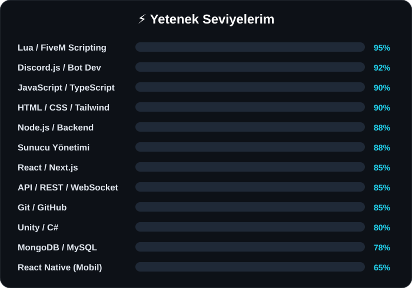

<!-- Header: animated wave -->

<!-- Typing animation -->

 

  

---

## 🧑‍💻 Hakkımda

Ben Bahadır, bir **Full Stack Developer**'ım. Profesyonel web siteleri tasarlıyor ve kodluyorum. Aynı zamanda **FiveM** ve diğer oyunlarda script yazıyor, oyun sunucuları kuruyor ve yönetiyorum. **Unity** ile oyun geliştirme süreçlerinde aktif rol alıyorum. Discord botları ve çeşitli otomasyon sistemleri üzerine de çalışıyorum.

- 🌐 **Full Stack Developer** — Web uygulamaları, API geliştirme ve modern frontend
- 🎮 **Game Developer** — Unity, FiveM script yazımı ve sunucu yönetimi
- 🤖 **Web & Bot Developer** — Discord botları, web siteleri ve otomasyon sistemleri

**Roller:** `Founder` · `Lead Developer` · `Full Stack Developer` · `Game Designer` · `Unity Developer` · `FiveM Developer`

 

---

## 🛠️ Tech Stack

  

---

## 🚀 Projeler

<table>
  <tr>
    <td width="33%" valign="top">
      <h3>🎮 KenziV FiveM</h3>
      
KenziV markası altında geliştirilen FiveM roleplay sunucusu. Özel scriptler, optimizasyon ve oyun içi sistemler.

      
<code>FiveM</code> <code>Lua</code>

      
🟢 <b>Devam ediyor · 2026</b>

    </td>
    <td width="33%" valign="top">
      <h3>🤖 KenziV Bot</h3>
      
KenziV sunucusu ile entegre Discord botu. Moderasyon, kayıt, otomasyon ve sunucu yönetimi.

      
<code>Discord.js</code> <code>Node.js</code>

      
🟢 <b>Devam ediyor · 2026</b>

    </td>
    <td width="33%" valign="top">
      <h3>🧠 NA Jarvis</h3>
      
PC üzerinde çalışan yapay zeka asistanı. Kendi HUD arayüzü ile konuşarak komut verilir, sistem işlemleri yönetilir.

      
<code>Python</code> <code>AI</code> <code>Desktop</code>

      
🟢 <b>Devam ediyor · 2026</b>

    </td>
  </tr>
  <tr>
    <td width="33%" valign="top">
      <h3>🔫 Bronx RPG</h3>
      
FiveM sunucusu için özel script geliştirme, optimizasyon ve kapsamlı roleplay deneyimi.

      
<code>FiveM</code> <code>Lua</code>

      
🟢 <b>Aktif</b>

    </td>
    <td width="33%" valign="top">
      <h3>🛡️ Bronx RPG Bot</h3>
      
Sunucu ile entegre gelişmiş moderasyon, kayıt ve otomasyon botu.

      
<code>Discord.js</code> <code>Node.js</code>

      
🟢 <b>Aktif</b>

    </td>
    <td width="33%" valign="top">
      <h3>🌍 Quakora</h3>
      
iOS mobil tabanlı deprem bilgilendirme ve erken uyarı sistemi.

      
<code>React Native</code> <code>API</code>

      
🧪 <b>Test aşamasında</b>

    </td>
  </tr>
  <tr>
    <td width="33%" valign="top">
      <h3><a href="https://nowace.me">✨ Nowace Web</a></h3>
      
Kişisel portfolyo sitesi. Shader efektli, tam animasyonlu modern tasarım.

      
<code>Next.js</code> <code>TypeScript</code> <code>Tailwind</code>

      
✅ <b>Yayında</b>

    </td>
    <td width="33%" valign="top">
      <h3>📦 FiveM Script Paketi</h3>
      
FiveM sunucuları için optimize edilmiş, modüler script koleksiyonu.

      
<code>Lua</code> <code>ESX</code> <code>QBCore</code>

      
🟢 <b>Aktif</b>

    </td>
    <td width="33%" valign="top">
      <h3>🖥️ Sunucu Yönetim Paneli</h3>
      
Oyun sunucularını yönetmek için web tabanlı kontrol paneli.

      
<code>Node.js</code> <code>React</code> <code>WebSocket</code>

      
🟢 <b>Aktif</b>

    </td>
  </tr>
</table>

---

## 📊 GitHub İstatistikleri

 

---

## 🐍 Katkı Yılanı

<picture>
  <source media="(prefers-color-scheme: dark)" srcset="https://raw.githubusercontent.com/Bahadir-Saygi/Bahadir-Saygi/output/github-snake-dark.svg" />
  <source media="(prefers-color-scheme: light)" srcset="https://raw.githubusercontent.com/Bahadir-Saygi/Bahadir-Saygi/output/github-snake.svg" />
  
</picture>

---

## 📫 İletişim

**Bir projen mi var? Birlikte çalışalım!**

 

